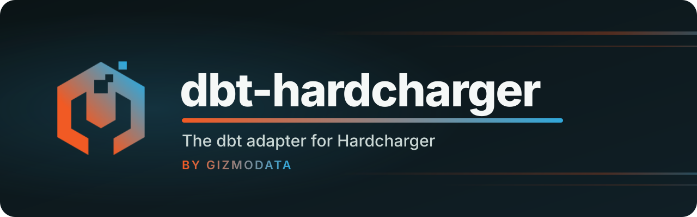

<p align="center">
  <a href="https://github.com/gizmodata/hardcharger">
    
  </a>
</p>

<p align="center">
  <a href="https://pypi.org/project/dbt-hardcharger/"></a>
  <a href="https://www.getdbt.com"></a>
  
  <a href="https://github.com/gizmodata/hardcharger-adbc"></a>
  <a href="https://github.com/gizmodata/warp-sql"></a>
  <a href="https://github.com/gizmodata/hardcharger"></a>
  <a href="LICENSE"></a>
  <a href="https://gizmodata.com"></a>
</p>

<h3 align="center">Build your dbt project on Hardcharger: remote DuckDB 2.0, over Warp SQL.</h3>

---

## 🔌 What is it?

The [dbt](https://www.getdbt.com) adapter for [Hardcharger™](https://github.com/gizmodata/hardcharger),
GizmoData™'s DuckDB 2.0 server. dbt connects through the
[Hardcharger ADBC driver](https://github.com/gizmodata/hardcharger-adbc) (`adbc-driver-hardcharger`),
which speaks [Warp SQL](https://github.com/gizmodata/warp-sql) over HTTPS: Arrow results, bulk
ingest, TLS by default, and every Hardcharger sign-in.

- 🧱 **Every materialization**: table, view, incremental (`append`, `delete+insert`, `merge`,
  `microbatch`), ephemeral, snapshots (check and timestamp), and `external` files written by
  the server (Parquet, CSV, JSON, partitioned, to local disk or object storage).
- 🐍 **Python models**, run on the dbt machine with a local DuckDB and shipped to the server by
  bulk ingest; record batch streams are streamed, and `session.remote_sql()` pushes a query
  down to the server.
- 🌱 **Seeds** read by DuckDB's CSV reader (real types and NULLs) and bulk-ingested.
- 🔐 **Every sign-in**: password, access token, client certificate (mutual TLS) and the
  server's browser sign-in.
- 🦆 **DuckLake catalogs**, constraints (enforced), `persist_docs`, `dbt docs generate`,
  `dbt show`, unit tests.

It is the Hardcharger port of [dbt-gizmosql](https://github.com/gizmodata/dbt-gizmosql), and
passes the same dbt adapter test suite ([Testing](#-testing)).

## 📦 Installation

Python 3.11 or newer. dbt-hardcharger and its driver aren't on PyPI yet, so install both from
their repositories (you need Go and a C compiler for the driver's library):

<!-- test: install -->
```bash
git clone git@github.com:gizmodata/hardcharger-adbc.git
git clone git@github.com:gizmodata/dbt-hardcharger.git
make -C hardcharger-adbc/go lib
python3 -m venv .venv
.venv/bin/pip install --editable hardcharger-adbc/python ./dbt-hardcharger
```

Once they are published this becomes `pip install dbt-hardcharger`.

## ⚡ Quick start

A Hardcharger server with a certificate (self-signed here), using the `hardcharger-server`
binary from a [Hardcharger release](https://github.com/gizmodata/hardcharger/releases/latest):

<!-- test: server -->
```bash
openssl req -x509 -newkey ec -pkeyopt ec_paramgen_curve:prime256v1 -nodes -days 30 \
  -subj /CN=localhost -addext subjectAltName=DNS:localhost -keyout server.key -out server.pem
HARDCHARGER_ADMIN_PASSWORD='change-me' hardcharger-server \
  --tls-cert server.pem --tls-key server.key --database shop.duckdb
```

A dbt project in the same directory. `dbt_project.yml`:

<!-- test: file dbt_project.yml -->
```yaml
name: shop
version: "1.0.0"
profile: shop
models:
  shop:
    +materialized: table
```

`profiles.yml` (dbt reads it from the project directory, or from `~/.dbt/`). TLS is on by
default, and `tls_root_certs` trusts the server's self-signed certificate:

<!-- test: file profiles.yml -->
```yaml
shop:
  target: dev
  outputs:
    dev:
      type: hardcharger
      host: localhost
      port: 31337
      user: hardcharger
      password: "{{ env_var('HARDCHARGER_PASSWORD') }}"
      tls_root_certs: server.pem
      database: shop
      schema: main
      threads: 4
```

Two seeds, `seeds/customers.csv` and `seeds/orders.csv`:

<!-- test: file seeds/customers.csv -->
```csv
id,name,signed_up
1,Ada,2026-01-05
2,Grace,2026-02-11
3,Linus,
```

<!-- test: file seeds/orders.csv -->
```csv
id,customer_id,amount,ordered_at
1,1,120.50,2026-03-01
2,1,35.00,2026-03-04
3,2,410.25,2026-03-09
4,3,15.75,2026-04-10
```

A model, `models/customer_orders.sql`, with tests in `models/schema.yml`:

<!-- test: file models/customer_orders.sql -->
```sql
select
    c.id as customer_id,
    c.name,
    count(o.id) as orders,
    sum(o.amount) as total_amount
from {{ ref('customers') }} c
left join {{ ref('orders') }} o on o.customer_id = c.id
group by all
order by customer_id
```

<!-- test: file models/schema.yml -->
```yaml
models:
  - name: customer_orders
    columns:
      - name: customer_id
        data_tests: [unique, not_null]
```

And a Python model, `models/big_spenders.py`:

<!-- test: file models/big_spenders.py -->
```python
def model(dbt, session):
    dbt.config(materialized="table")
    return dbt.ref("customer_orders").filter(expr="total_amount > 100").order("customer_id")
```

Load the seeds, build the models, run the tests, and look at the result:

<!-- test: shell -->
```bash
export HARDCHARGER_PASSWORD='change-me'
dbt seed
dbt run
dbt test
dbt show --select big_spenders
```

<!-- test: output -->
```text
| customer_id | name  | orders | total_amount |
| ----------- | ----- | ------ | ------------ |
|           1 | Ada   |      2 |       155.50 |
|           2 | Grace |      1 |       410.25 |
```

## 🔐 Profiles and sign-in

| Option | Default | Description |
| --- | --- | --- |
| `host` | (required) | The server's host name. |
| `port` | `31337` | The server's Warp SQL port. |
| `database` | the server's | The catalog dbt builds in (also `catalog`, `dbname`). |
| `schema` | the server's | The schema dbt builds in. |
| `auth_type` | `password` (`token` when a `token` is given) | `password`, `token`, `client_certificate` or `external` (browser sign-in). |
| `user`, `password` | | For `auth_type: password`. |
| `token` | | A Hardcharger access token, for `auth_type: token`. |
| `tls` | `true` | `false` for plain HTTP to a development server. dbt-hardcharger never falls back to plain HTTP by itself. |
| `tls_root_certs` | the system's | CA certificates to trust: a file path or PEM text. |
| `tls_skip_verify` | `false` | Don't verify the server's certificate (development only). |
| `tls_client_cert`, `tls_client_key` | | A client certificate and its key (path or PEM), for mutual TLS: with `auth_type: client_certificate` they are the credential; with a password they only admit the connection. |
| `oauth_url`, `oauth_port` | `https://HOST:31339` | The server's browser sign-in endpoint (`--oauth-base-url`, `--oauth-port`), for `auth_type: external`. |
| `oauth_browser` | the system browser | The command that opens the sign-in page (the URL is appended), or `none` to print the URL. |
| `external_root` | `.` | Where `external` models write when they don't name a `location` ([below](#-external-files-written-by-the-server)). Resolved on the server. |
| `threads` | `1` | dbt's parallelism. |

**An access token** from somewhere else, for example Hardcharger's token endpoint (here with
the quick start's server):

<!-- test: shell token -->
```bash
export HARDCHARGER_TOKEN=$(curl -s --cacert server.pem https://localhost:31337/warp/v1/auth/token \
  -H 'Content-Type: application/json' \
  -d '{"grant_type": "password", "username": "hardcharger", "password": "change-me"}' | jq -r .access_token)
```

<!-- test: profile token -->
```yaml
shop:
  target: dev
  outputs:
    dev:
      type: hardcharger
      host: localhost
      auth_type: token
      token: "{{ env_var('HARDCHARGER_TOKEN') }}"
      tls_root_certs: server.pem
```

**A client certificate** signs in without a password on a server that verifies client
certificates and lets them sign in (here `analyst@example.com`, the certificate's e-mail
address, is an administrator; see Hardcharger's README, "Client certificates as identity"):

<!-- test: server mtls -->
```bash
HARDCHARGER_ADMIN_PASSWORD='change-me' hardcharger-server \
  --tls-cert server.pem --tls-key server.key --mtls-ca-cert ca.pem \
  --mtls-certificate-sign-in --mtls-admin-identities analyst@example.com
```

<!-- test: profile mtls -->
```yaml
shop:
  target: dev
  outputs:
    dev:
      type: hardcharger
      host: localhost
      auth_type: client_certificate
      tls_root_certs: ca.pem
      tls_client_cert: analyst.pem
      tls_client_key: analyst-key.pem
```

**Browser sign-in** through the server's identity provider (a server started with
`--oauth-client-id`): dbt opens the sign-in page once per run, and every connection of the run
shares that sign-in.

<!-- test: profile external -->
```yaml
shop:
  target: dev
  outputs:
    dev:
      type: hardcharger
      host: localhost
      auth_type: external
      tls_root_certs: ca.pem
```

## 🐍 Python models

Python models run on the dbt machine, in a local DuckDB, so the whole DuckDB Python API is
there; the result goes to Hardcharger by ADBC bulk ingest. `dbt.ref()` and `dbt.source()` fetch
their relation from the server as Arrow and hand it over as a DuckDB relation (with pandas-style
column access). A model may return a DuckDB relation, a pandas DataFrame, a `pyarrow.Table`, or
Arrow record batches:

- a `pyarrow.RecordBatch` or a `pyarrow.RecordBatchReader`;
- a list or a generator of `pyarrow.RecordBatch`es;
- any object with the [Arrow PyCapsule stream protocol](https://arrow.apache.org/docs/format/CDataInterface/PyCapsuleInterface.html)
  (`__arrow_c_stream__`, a polars DataFrame for instance).

Readers, generators and stream objects are **streamed** to the server batch by batch, so the
whole result never has to fit in the dbt machine's memory (`models/numbers.py`):

<!-- test: file models/numbers.py -->
```python
import pyarrow as pa


def model(dbt, session):
    dbt.config(materialized="table")
    schema = pa.schema(fields=[("id", pa.int64()), ("label", pa.string())])

    def batches():
        for start in (0, 1000, 2000):
            ids = list(range(start, start + 1000))
            yield pa.record_batch(data={"id": ids, "label": [f"n{i}" for i in ids]}, schema=schema)

    return pa.RecordBatchReader.from_batches(schema=schema, batches=batches())
```

dbt wants `model()` itself to `return` once, so the `yield`s go in an inner function. A stream
with no rows still creates its (empty, typed) table; an empty list or generator has no schema,
so return an empty `RecordBatchReader` or `Table` with an explicit schema instead.

**Streaming from another database.** A returned reader is read *after* `model()` returns, so its
source must still be open then. A reader from an ADBC `cursor.fetch_record_batch()` closes with
its cursor, so don't `return` it from inside a `with` block (the model fails with "returned a
record batch stream that was already closed"): **`yield`** it instead. dbt-hardcharger streams
the reader, then resumes the generator, and the `with` block closes the connection. Any ADBC
driver works; here the source is another Hardcharger server (`models/copied_orders.py`):

<!-- test: file models/copied_orders.py -->
```python
import os

from adbc_driver_hardcharger import dbapi as hardcharger


def extract(query):
    with (
        hardcharger.connect(
            uri=os.environ["SOURCE_URI"],
            username=os.environ["SOURCE_USERNAME"],
            password=os.environ["SOURCE_PASSWORD"],
            tls_root_certs=os.environ["SOURCE_TLS_ROOT_CERTS"],
        ) as conn,
        conn.cursor() as cursor,
    ):
        cursor.execute(operation=query)
        yield cursor.fetch_record_batch()  # `yield`, not `return`


def model(dbt, session):
    dbt.config(materialized="table")
    return extract(query="select * from shop.main.orders")
```

This works for incremental models too, and an empty result still creates the (empty) table. To
collect the whole result first instead, `return cursor.fetch_arrow_table()`.

**Pushing a query down with `session.remote_sql()`.** `dbt.ref("big_table").filter(...)` brings
the whole table to the dbt machine before filtering it. `session.remote_sql(query)` runs the
query on the server, and only its result crosses the network (`models/large_orders.py`):

<!-- test: file models/large_orders.py -->
```python
def model(dbt, session):
    dbt.config(materialized="table")
    orders = f"{dbt.this.database}.{dbt.this.schema}.orders"
    # Runs on the Hardcharger server; only the matching rows come back.
    return session.remote_sql(query=f"select * from {orders} where amount > 100")
```

It returns a local DuckDB relation (chain `.filter()`, `.project()`, `.df()`, ...). The rest
of `session` is the local DuckDB connection (`session.sql()`, `session.register()`, ...).

## 🌱 Seeds

Seeds are read by DuckDB's CSV reader on the dbt machine and bulk-ingested: empty fields become
`NULL` (not the text `'null'`), dates are `DATE`, integers `BIGINT`, and so on. `column_types`
and `delimiter` work as in other adapters, and it is much faster than dbt's default batches of
`INSERT`s.

## 📤 External files written by the server

`materialized='external'` writes a model to Parquet, CSV or JSON files with DuckDB's `COPY`, and
creates a view over them for downstream models to `ref()`. The config is
[dbt-duckdb](https://github.com/duckdb/dbt-duckdb?tab=readme-ov-file#writing-to-external-files)'s.
**The `COPY` runs on the Hardcharger server, not on the dbt machine**: paths are the server's,
and so are the credentials for object storage (`s3://`, `gs://`, `azure://`, ...). That's
usually what you want: the server has the CPUs, the network and the cloud role, and the result
never travels to the dbt machine and back.

`models/orders_export.sql` writes `orders_export.parquet` in `external_root` (by default the
server's working directory); `models/orders_by_month.sql` writes one zstd Parquet directory per
month:

<!-- test: file models/orders_export.sql -->
```sql
{{ config(materialized='external') }}
select * from {{ ref('orders') }}
```

<!-- test: file models/orders_by_month.sql -->
```sql
{{ config(
    materialized='external',
    options={'partition_by': 'month', 'compression': 'zstd'}
) }}
select *, strftime(ordered_at, '%Y-%m') as month from {{ ref('orders') }}
```

| Option | Default | Description |
| :---: | :---: | --- |
| `location` | [`external_location`](dbt/include/hardcharger/macros/utils/external_location.sql) | The server-side path or URI to write. |
| `format` | `parquet` | `parquet`, `csv` or `json`; inferred from the `location`'s extension when not given. |
| `delimiter` | `,` | The CSV field delimiter. |
| `options` | `{}` | Other options for DuckDB's `COPY`: `compression`, `partition_by`, `codec`, `per_thread_output`, ... |
| `parquet_read_options` | `{'union_by_name': False}` | Options for `read_parquet()` in the view. |
| `csv_read_options` | `{'auto_detect': True}` | Options for `read_csv()`. |
| `json_read_options` | `{'auto_detect': True}` | Options for `read_json()`. |

A single-file `COPY` doesn't create directories, so the directory of a `location` (or
`external_root`) must exist on the server; object storage URIs have no directories to create.
External models are always rebuilt in full (no incremental strategies), and dbt-duckdb's
client-side `plugin` and `glue_register` options are refused with an error.

## 🦆 DuckLake catalogs

Set `database` to a [DuckLake](https://ducklake.select/) catalog attached to the server and dbt
builds there. dbt-hardcharger finds DuckLake catalogs in `duckdb_databases()` and works around
what DuckLake doesn't support: it replaces relations without `DROP ... CASCADE`, creates only
`NOT NULL` contract constraints (the others, and the `indexes` config, are skipped with a
warning; `warn_unsupported: false` silences one), so a shared `schema.yml` still builds.

DuckLake holds its metadata transaction open, with its Postgres session idle, for the whole of
a write, and a streamed Python model result keeps it open while the *source* produces its
batches. A metadata server whose `idle_in_transaction_session_timeout` is shorter kills the
write at commit (`Failed to commit: Failed to execute query "ROLLBACK": `; the adapter adds a
hint). Raise the timeout for the catalog's role (`ALTER ROLE <catalog_role> SET
idle_in_transaction_session_timeout = '2h'`), or return `cursor.fetch_arrow_table()` instead of
streaming from a slow source.

## 🧩 Also

- **Constraints**: `check`, `not_null`, `unique`, `primary_key` and `foreign_key`, all enforced.
- **Documentation**: `persist_docs` (`COMMENT ON` relations and columns) and `dbt docs generate`.
- **Macros**: DuckDB versions of `dateadd`, `last_day`, `listagg` and `split_part`.
- **Grants**: dbt's `grants` config isn't applied yet (dbt-hardcharger warns); run Hardcharger
  `GRANT` statements in a `post-hook` meanwhile.
- **Transactions**: every statement commits on its own (autocommit), as in dbt-gizmosql.

## 🔁 Coming from dbt-gizmosql

The same features and macros; the profile changes:

| dbt-gizmosql | dbt-hardcharger |
| --- | --- |
| `type: gizmosql` | `type: hardcharger` |
| `use_encryption` (`use_tls`), on by default | `tls`, on by default |
| `tls_skip_verify` (`disable_certificate_verification`) | `tls_skip_verify` |
| (none) | `tls_root_certs`, `tls_client_cert`, `tls_client_key` |
| `auth_type: external` | `auth_type: external` (and `oauth_url`, `oauth_port`, `oauth_browser`) |
| (none) | `auth_type: token` with `token`, `auth_type: client_certificate` |
| `adbc_driver_gizmosql` in Python models | `adbc_driver_hardcharger` |

## 🧪 Testing

The suite is dbt's adapter test suite ([dbt-tests-adapter](https://github.com/dbt-labs/dbt-adapters/tree/main/dbt-tests-adapter)),
dbt-gizmosql's own tests, sign-in tests and this README: its marked examples run as written
against real servers (`tests/functional/test_readme.py`), and CI installs the package with the
[Installation](#-installation) commands. The tests start `hardcharger-server` processes on
free loopback ports from `DBT_HARDCHARGER_TEST_SERVER_BINARY`; without it they fail, never skip.
The S3 test needs an S3 gateway at `DBT_HARDCHARGER_TEST_S3_ENDPOINT` (default `127.0.0.1:9000`).

On a Mac (or anywhere with Docker), `scripts/test-in-docker.sh` runs it all in a Linux container,
with the server from `ghcr.io/gizmodata/hardcharger:main` and the driver built from the
hardcharger-adbc commit pinned in `.github/hardcharger-adbc.ref`:

```bash
DBT_HARDCHARGER_TEST_ADBC_SRC=~/git/hardcharger-adbc scripts/test-in-docker.sh -n 6
```

Lint, format and type checks: `ruff check .`, `ruff format --check .` and `mypy`.

## 📦 Releasing

[Semantic versioning](https://semver.org) and [CHANGELOG.md](CHANGELOG.md). A `vX.Y.Z` tag runs
the whole CI on the tagged commit (`release.yml` calls `ci.yml`), then builds the wheel and
sdist and creates a GitHub Release with the tag's CHANGELOG section. PyPI publishing comes when
dbt-hardcharger and adbc-driver-hardcharger go public.

## 📄 License

Apache License 2.0; see [LICENSE](LICENSE).

---

<p align="center">
  <a href="https://gizmodata.com"></a><br>
  <sub>Built by <a href="https://gizmodata.com">GizmoData™</a></sub>
</p>

<p align="center"><sub>Hardcharger™ and GizmoData™ are trademarks of GizmoData LLC. dbt is a trademark of dbt Labs, Inc.</sub></p>
